<div align="center">


# Recurse

**Learn it. Keep it. Show it.**

An interactive learning app built on spaced repetition. Short lessons with simulators and labs,<br />
a Cisco IOS console, coding challenges in JavaScript and Python, quizzes, timed exams and projects,<br />
organized into paths that take you from zero to the CCNA or a software engineering internship.

[](https://github.com/H4ch1Net/Recurse/actions/workflows/ci.yml)


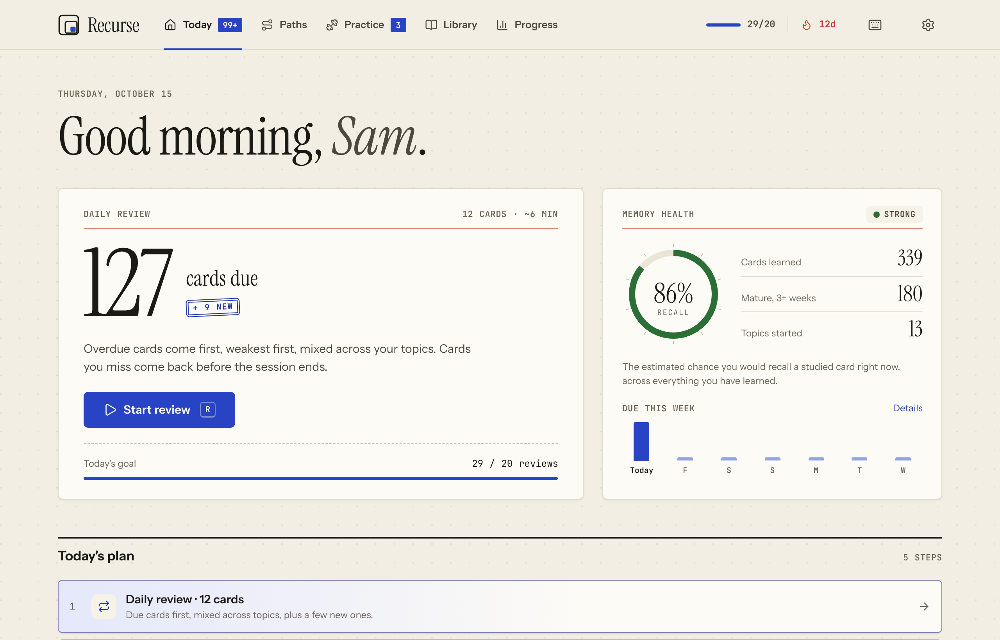

</div>

## What it is

Most people forget about half of what they read within a day or two. Rereading and highlighting feel
productive but barely slow that down. What reliably works is **retrieving** an answer from memory,
**spacing** those retrievals out, **mixing** topics, and **doing** the thing: typing the command,
writing the function, explaining the idea in your own words.

Recurse is built around that. Each topic is a lesson you interact with (sort an array step by step,
elect a spanning-tree root bridge, follow a packet through NAT, configure a router in a simulated IOS
console), followed by a bank of questions. The [FSRS](https://github.com/open-spaced-repetition/fsrs4anki/wiki/The-Algorithm)
scheduler tracks every card, lab and coding challenge, and brings each one back right before you would
forget it. Paths put the topics in order for a goal and tell you how ready you are.

It runs entirely in the browser. There is no account and no tracking. Progress is stored in
`localStorage` and can be exported as a backup at any time.

## Features

| | |
|---|---|
| **Paths to a goal** | Six paths: CCNA 200-301, Software Engineering Internship, Computer Science Fundamentals, Web Development, Security Foundations and a Math Toolkit. Each has ordered stages, labs, challenge sets, projects and a readiness score. |
| **106 topics, 3,373 questions** | Eleven subjects. CCNA covers every item in the 200-301 v1.1 blueprint across 36 topics. SWE covers interview patterns, testing, debugging, databases, APIs, system design, résumés and interviews. |
| **36 interactive simulators** | Sorting, binary search, Big-O growth, BST, graph search, recursion trees, DP tables, logic gates, CPU scheduling, regex, HTTP, git, a Linux terminal, subnetting, the OSI model, TCP handshakes, MAC learning, STP elections, VLAN trunks, route lookup, ACLs, NAT, DHCP, IPv6 and OSPF cost, among others. They sit inside lessons and in the practice hub. |
| **Cisco IOS console labs** | 30 labs in a simulated IOS CLI with abbreviations, `?` help, tab completion, `show` output and multi-device topologies. Build VLANs, trunks, EtherChannel, OSPF, HSRP, NAT, ACLs, port security and more, and troubleshoot broken networks. Each lab is checked against its goals. |
| **Coding challenges** | 87 problems in 15 sets that follow the patterns interviews use, solved in JavaScript or Python (Pyodide) against visible and hidden tests, with staged hints and a reference solution. |
| **Nine question types** | Multiple choice, select all, put in order, match pairs, fill the blank, find the bug, type the answer, type the command (IOS, bash, git, SQL, Docker with abbreviation matching), and open recall. |
| **Quizzes and exams** | A quiz gives feedback after each question. An exam is timed, lets you flag and jump between questions, and scores only at the end, weighted by the path's blueprint. Every answer feeds the review schedule. |
| **Recall that keeps coming back** | Daily review mixes due cards from every topic. Pop quizzes drop earlier questions into sessions and lessons, lessons open with a warm-up on what you studied before, and Recall roulette pulls random questions from everything you have seen. Labs and challenges come due for a redo too. |
| **Explain it (Feynman)** | Write a plain-language explanation for a chosen audience. Key terms light up as you use them. An AI tutor (with your own key) says what is right and what is missing, and asks a follow-up until you have it. Works offline with a self-check. |
| **Ways to learn, measured** | A short quiz suggests an approach (hands-on first, see it first, test me first, teach it back, or balanced) and a 10-minute recall experiment measures which study method actually worked best for you. Recurse then tracks your recall by approach. |
| **Portfolio and projects** | 12 guided projects with milestones (a CLI task manager, a REST API, a full stack app, a multi-site OSPF network, and more). Finished work, labs, challenges and exam scores collect on a portfolio page you can export as Markdown. |
| **Feedback that feels good** | A short tone on each correct answer that climbs with your streak, particle bursts, combo counters, confetti on level-ups and finished sessions. Three effect levels, volume control, and full respect for reduced motion. |
| **Themes and accents** | Ten themes (Paper, Ink, Midnight, Terminal, Nebula, Forest, Sakura, Solar, Ocean, High contrast) and ten accent colors plus a custom hue. |
| **Built for daily use** | Keyboard shortcuts for everything, a mobile layout with a tab bar, installable PWA that works offline. |

<details>
<summary><b>All topics by subject</b></summary>

| Subject | Topics |
|---|---|
| Programming (9) | Asynchronous JavaScript, Intermediate Python, JavaScript Basics, Loops and Functions, Object-Oriented Programming, Python Basics, SQL Basics, TypeScript Basics, Variables and Types |
| Computer Science (8) | Algorithms, Big-O and Complexity, Computer Architecture, Data Structures, How Code Runs, Number Systems and Data Representation, Operating Systems, System Design 101 |
| Software Engineering (28) | Arrays and Strings, Behavioral Interviews, Binary Search, Binary Trees and BSTs, Bit Manipulation, Clean Code, Concurrency and Async, Databases in Practice, Debugging, Design Patterns and SOLID, Dynamic Programming, Finding an Internship, Git in a Team, Graphs: BFS, DFS and Beyond, Greedy Algorithms and Intervals, Hash Maps and Sets, Heaps and Priority Queues, Linked Lists, Recursion and Backtracking, REST APIs in Practice, Resume, GitHub and Portfolio, Secure Coding for the Web, Sliding Window, Stacks and Queues, System Design Interviews, Technical Interview Playbook, Testing Your Code, Two Pointers |
| Developer Tools (4) | Docker Basics, Git Basics, Linux Command Line, Regular Expressions |
| Web (2) | How the Web Works, HTML & CSS |
| Networking (37) | Access Control Lists, AI and Machine Learning in Network Operations, Automation and Controller-Based Networking, Cabling and Interface Errors, CDP and LLDP, Configuration Management: Ansible and Terraform, Device Access Security, Device Management Access, DHCP and DNS, EtherChannel, Ethernet Switching, First Hop Redundancy, Inter-VLAN Routing, IPv4 Addressing, IPv6 Addressing, Layer 2 Security, NAT and PAT, Network Components and Architectures, Networking Basics, NTP, SNMP and Syslog, OSI, TCP/IP, TCP and UDP, OSPF, Quality of Service (QoS), REST APIs and JSON, Routing Table and Forwarding, Security Concepts, Spanning Tree, SSH, TFTP and FTP, Static Routing, Subnetting, Trunking, Virtualization and Client IP Settings, VLANs, VPNs and IPsec, Wireless Architectures, Wireless Principles, Wireless Security |
| Security (2) | Cryptography Basics, Cybersecurity 101 |
| Mathematics (5) | Algebra Essentials, Calculus Foundations, Linear Algebra Basics, Logic & Discrete Math, Probability & Statistics |
| Science (4) | Biology: Cells & Genetics, Chemistry Basics, Earth & Space Science, Physics: Mechanics |
| Humanities (4) | Economics Basics, How Learning Works, Modern World History, World Geography |
| Languages (3) | French Essentials, Japanese: Hiragana, Spanish Essentials |

</details>

## Screenshots

<table>
  <tr>
    <td width="50%">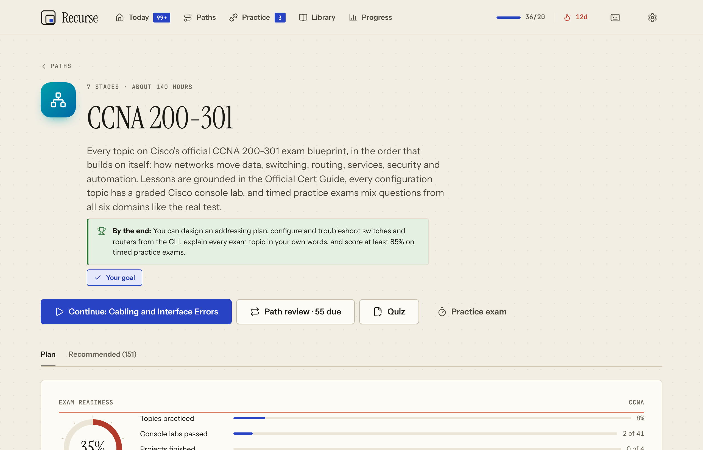<br /><sub>CCNA path with blueprint stages and readiness</sub></td>
    <td width="50%">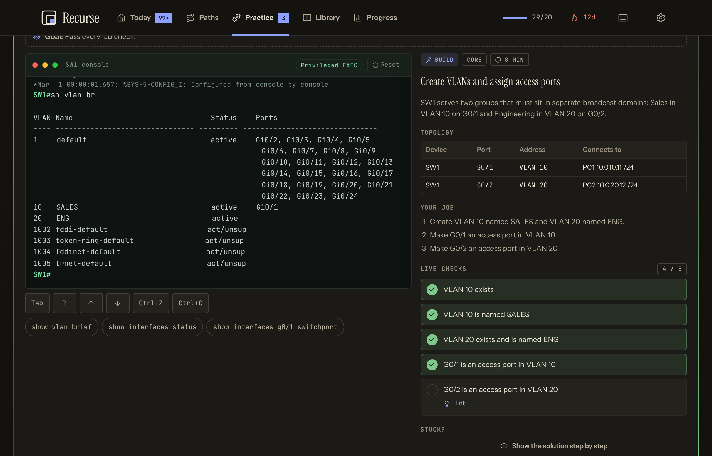<br /><sub>IOS console lab</sub></td>
  </tr>
  <tr>
    <td>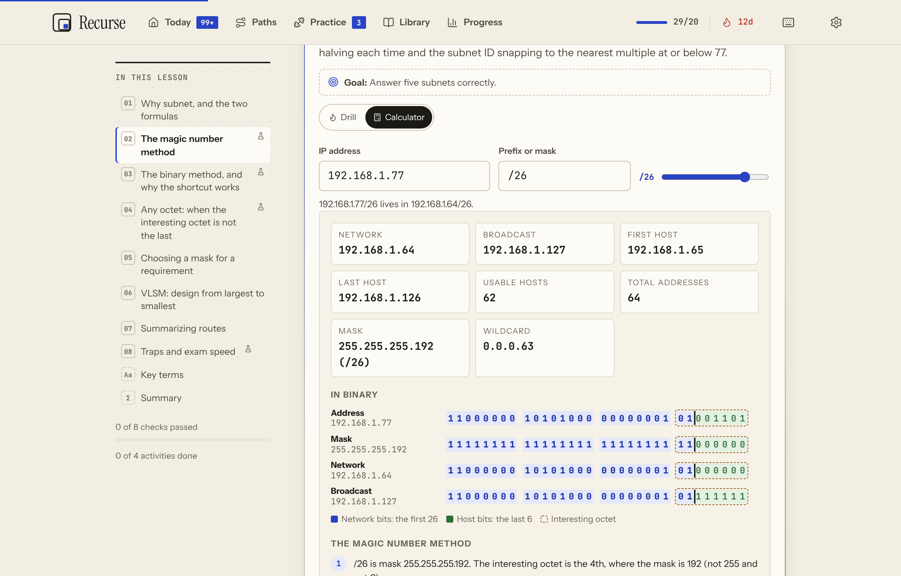<br /><sub>Activity inside a lesson</sub></td>
    <td>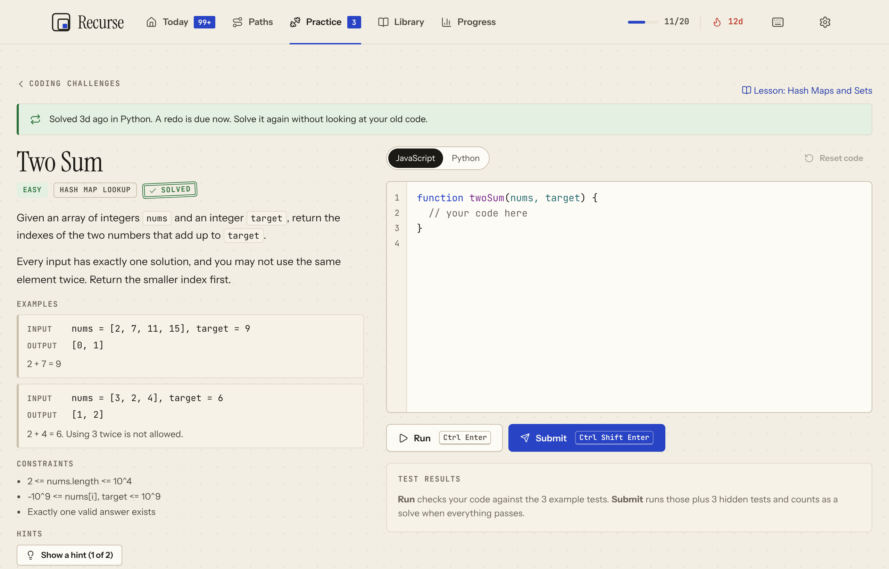<br /><sub>Coding challenge</sub></td>
  </tr>
  <tr>
    <td>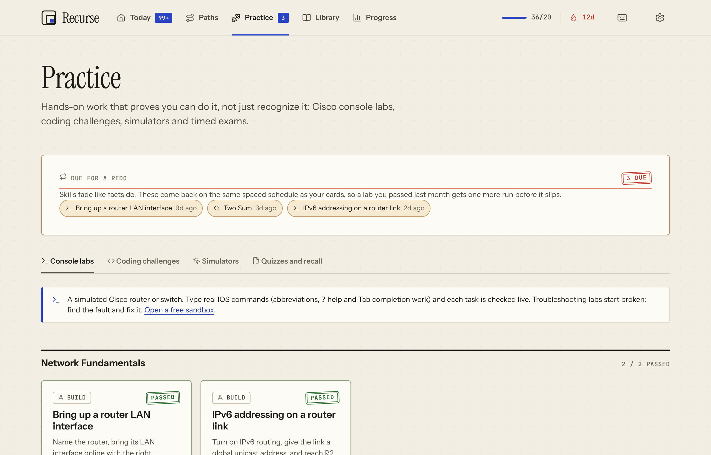<br /><sub>Practice hub</sub></td>
    <td>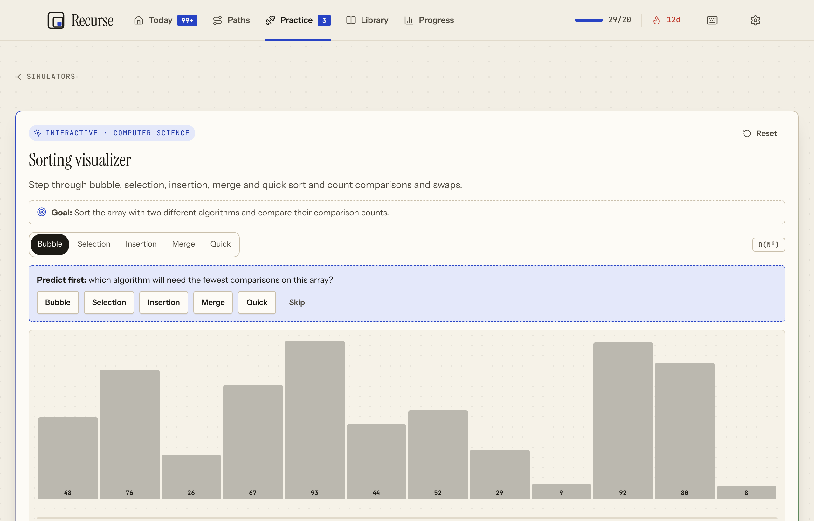<br /><sub>Simulator</sub></td>
  </tr>
  <tr>
    <td>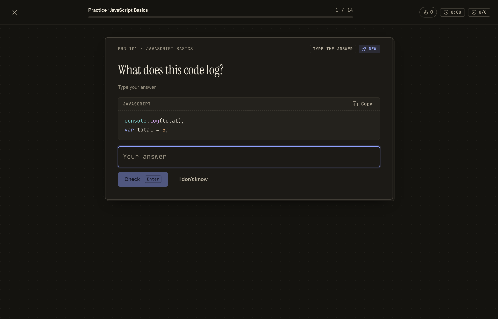<br /><sub>Study session, dark theme</sub></td>
    <td>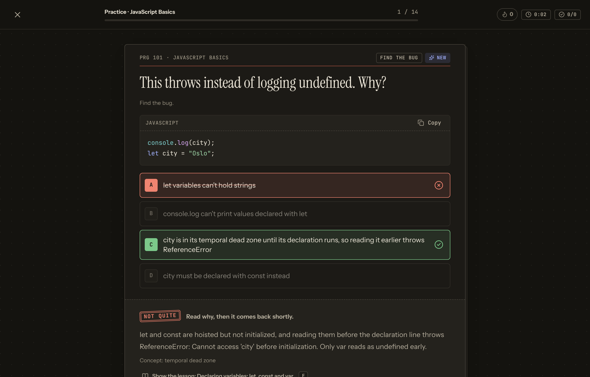<br /><sub>Feedback with explanation and lesson excerpt</sub></td>
  </tr>
  <tr>
    <td>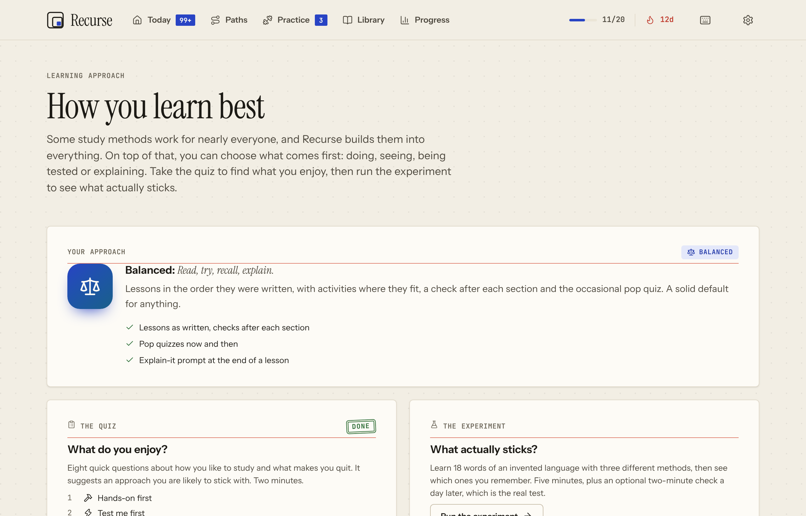<br /><sub>Ways to learn</sub></td>
    <td>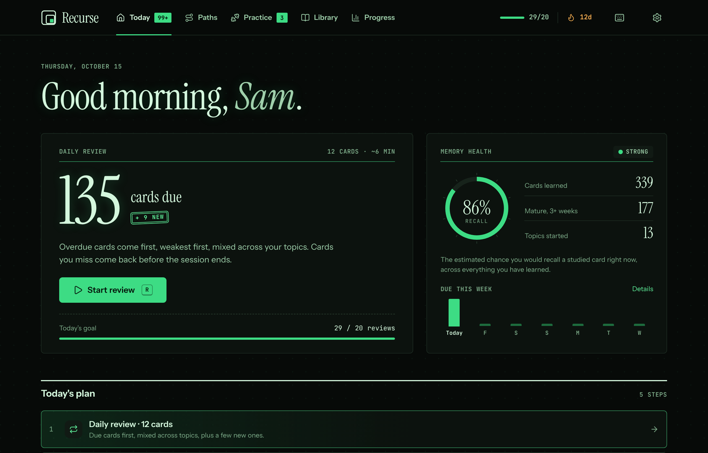<br /><sub>Terminal theme</sub></td>
  </tr>
  <tr>
    <td>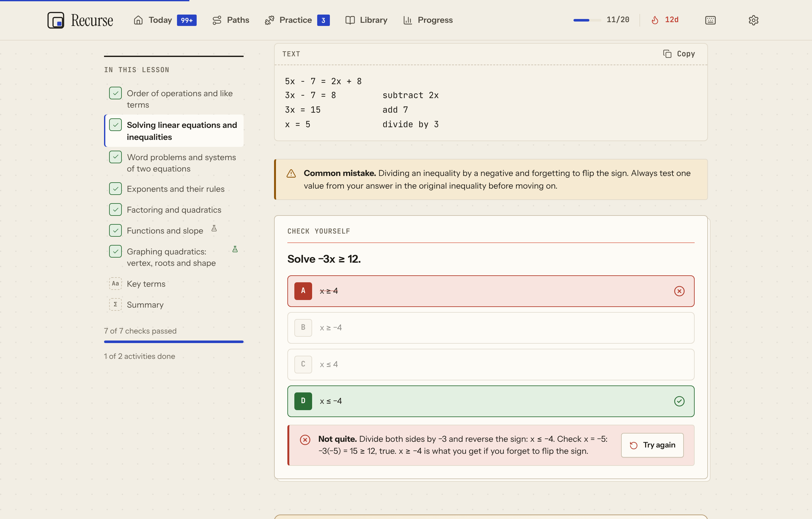<br /><sub>Lesson with section checks</sub></td>
    <td>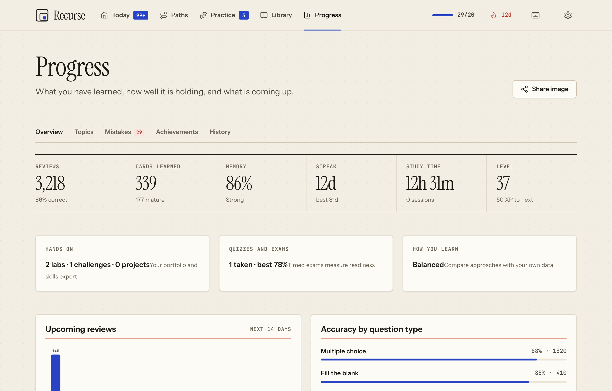<br /><sub>Progress</sub></td>
  </tr>
</table>

<p align="center">
  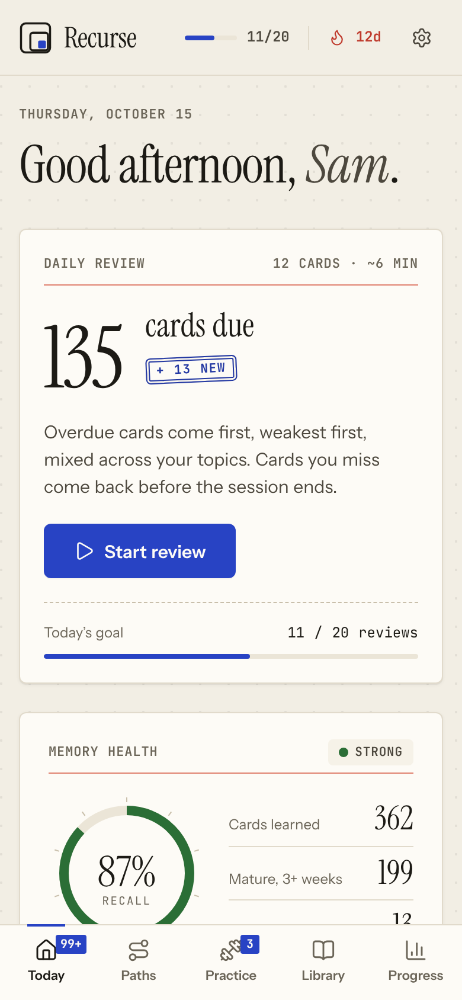
  &nbsp;&nbsp;
  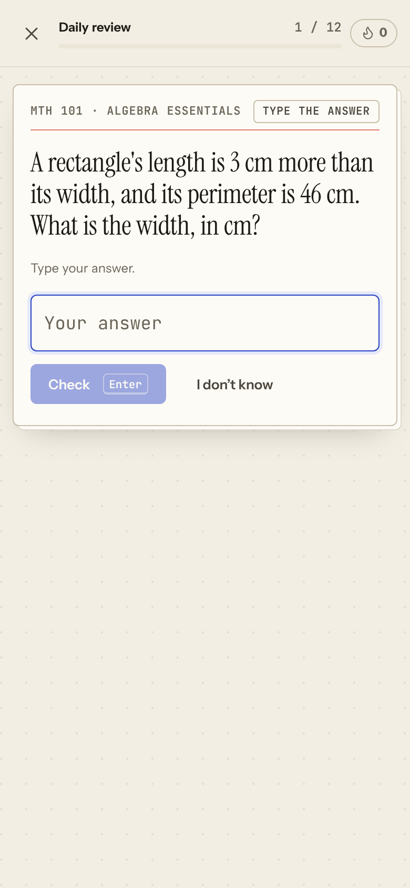
</p>

## Paths

| Path | Stages | What you finish with |
|---|---|---|
| **CCNA 200-301** | Network Fundamentals 20%, Network Access 20%, IP Connectivity 25%, IP Services 10%, Security Fundamentals 15%, Automation and Programmability 10% | Every blueprint topic, 30 console labs, 4 network projects and a 100-question, 120-minute practice exam |
| **Software Engineering Internship** | Programming foundations, tools of the trade, CS core, interview patterns I and II, building real software, systems and scale, getting hired | Pattern-by-pattern coding challenges, 8 portfolio projects, a résumé and an interview playbook |
| **Computer Science Fundamentals** | The machine, systems, data structures and algorithms, math for computing, security | How a computer runs your code, from bits to processes |
| **Web Development** | The front end, how the web works, the back end | HTML, CSS, JavaScript, HTTP, APIs and databases, with 2 projects |
| **Security Foundations** | Foundations, cryptography, defending systems | Threats, crypto, network and web security |
| **Math Toolkit** | Core, uncertainty and data, vectors and change | The math programming and data lean on |

A path's **readiness** combines how much of each stage you have practiced (weighted by the stage's share
of the blueprint) with labs passed, challenges solved, projects finished and practice exam scores. On
the CCNA path, readiness stops at 60% until you take a practice exam: the exam is what tells you whether
it holds up under time pressure.

## Ways to learn

People do have preferences, and enjoying how you study keeps you studying. But the research is clear
that labeling yourself a "visual learner" and only studying that way does not improve results
(Pashler et al., 2008). So Recurse keeps the methods that work for everyone in every mode and lets you
choose what comes first:

| Approach | What changes |
|---|---|
| **Balanced** | Lessons in order, activities where they fit, a check after each section |
| **Hands-on first** | Labs, simulators and challenges come before the reading |
| **See it first** | Diagrams and visualizations open each section |
| **Test me first** | A question before each section (pretesting), more pop quizzes |
| **Teach it back** | "Say it in your words" prompts after sections and a Feynman round at the end |

| Method | Evidence | Where it shows up |
|---|---|---|
| Retrieval practice | High (Roediger and Karpicke 2006; Dunlosky et al. 2013) | Every card, check, pop quiz and exam |
| Spaced practice | High (Cepeda et al. 2006) | FSRS scheduling for cards, labs and challenges |
| Interleaving | Moderate (Rohrer and Taylor 2007; Brunmair and Richter 2019) | Daily review, pop quizzes, recall roulette |
| Pretesting | Moderate (Kornell, Hays and Bjork 2009) | Test-me-first mode |
| Self-explanation | Moderate (Chi et al. 1994; Fiorella and Mayer 2013) | Feynman screen, teach-it-back prompts |
| Words plus visuals | Moderate (Mayer 2009) | Simulators and diagrams |
| Worked examples | Moderate (Sweller and Cooper 1985) | Step-by-step traces, staged hints |

The **recall experiment** teaches 18 made-up words with three methods (rereading, self-testing and
picturing), distracts you for a minute, then tests all of them. You see your own numbers, and you can
come back a day later to see what lasted.

## How a card moves through Recurse

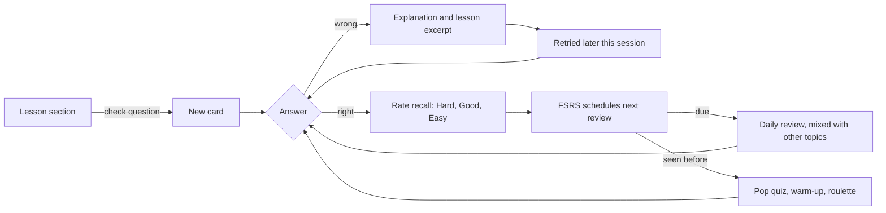

- A wrong answer is always graded **Again**. Rating buttons only appear when you got it right (or for
  open recall cards, where you judge yourself), and each one shows when the card will come back.
- Labs and challenges have their own schedule. Solving without hints counts as **Easy**, with one hint
  **Good**, with more **Hard**, and after viewing the solution **Again**. When one comes due it shows up
  under Practice to redo.
- **Memory** is the model's estimate of the chance you would recall a card right now. It decays
  continuously between reviews.
- **Mastery** averages how stable each card's memory is, counting unstudied cards as zero. A card counts
  as fully learned at three weeks of stability.

## Getting started

Requires Node.js 20.19 or newer.

```bash
git clone https://github.com/H4ch1Net/Recurse.git
cd Recurse/Recurse
npm install
npm run dev
```

Open http://localhost:5173. The first visit asks what you are working toward, suggests a way to learn
and picks a first topic.

### Commands

Run from the `Recurse/` directory.

| Command | What it does |
|---|---|
| `npm run dev` | Development server with hot reload |
| `npm run build` | Production build to `dist/` |
| `npm run preview` | Serve the production build locally |
| `npm test` | Unit tests (Vitest), including the IOS simulator and every widget |
| `npm run lint` | ESLint |
| `npm run validate:packs` | Check every built-in pack against the strict schema |
| `npm run validate:challenges` | Run every challenge's reference solutions in JavaScript and Python against its tests |
| `npm run validate:content` | Cross-check paths, labs, challenges, projects and activity references, and look for em dashes |
| `npm run validate` | All three validators |
| `npm run check` | Lint, validate, test and build in one go (what CI runs) |
| `npm run screenshots` | Rebuild `docs/screenshots/` from the production build with demo data. Needs Playwright Chromium |
| `npm run icons` | Regenerate the PNG app icons in `public/` |

`validate:challenges` needs `python3` on the path.

### Keyboard shortcuts

| Where | Keys |
|---|---|
| Anywhere | <kbd>T</kbd> Today, <kbd>P</kbd> Paths, <kbd>X</kbd> Practice, <kbd>L</kbd> Library, <kbd>S</kbd> Progress, <kbd>,</kbd> Settings, <kbd>?</kbd> list all shortcuts |
| Today and Library | <kbd>R</kbd> start daily review, <kbd>/</kbd> search |
| Studying | <kbd>A</kbd>-<kbd>F</kbd> choose, <kbd>1</kbd>-<kbd>9</kbd> place the next step in an order question, <kbd>Enter</kbd> submit or continue, <kbd>1</kbd>-<kbd>4</kbd> rate, <kbd>E</kbd> lesson excerpt, <kbd>Z</kbd> undo, <kbd>Esc</kbd> leave |

## Configuration

Everything is set in the app under **Settings** and stored locally.

| Setting | Default | Notes |
|---|---|---|
| Daily goal | 20 reviews | Shown in the header and on Today |
| New cards per day | 15 | Limits new cards in the daily review. Studying a topic directly is not limited |
| Session length | 12 cards | Missed cards are retried on top of this |
| Target retention | 90% | Higher means shorter intervals and more reviews |
| Way to learn | Balanced | Hands-on first, see it first, test me first, teach it back |
| Pop quizzes | Sometimes | Off, sometimes or often |
| Lesson warm-ups | On | A few questions from earlier topics before a new lesson |
| Theme and accent | System, theme accent | Ten themes, ten accents and a custom hue |
| Sound and effects | On, full | Volume, and full, calm or off effects |
| Focus timer | Off | Optional countdown during sessions with a break reminder |

### Optional AI features

Feynman feedback and pack generation need an API key from one of these providers. The key stays
in the browser and requests go directly from your browser to the provider. Everything else works without it.

| Provider | Default model | Key |
|---|---|---|
| Anthropic | `claude-haiku-4-5` | [console.anthropic.com](https://console.anthropic.com/settings/keys) |
| OpenAI | `gpt-4o-mini` | [platform.openai.com](https://platform.openai.com/api-keys) |
| OpenRouter | `google/gemma-3-4b-it:free` | [openrouter.ai](https://openrouter.ai/keys) |

Any model the provider offers can be entered in Settings. Use **Test connection** to check the key.

## Adding content

Everything is a JSON file. A new file shows up in the app with no code changes.

| Content | Folder | Guide |
|---|---|---|
| Topics (lesson, questions, activities) | `src/data/packs/` | [`docs/packs.md`](Recurse/docs/packs.md) |
| Interactive activities | `src/activities/widgets/` | [`docs/activities.md`](Recurse/docs/activities.md) |
| Coding challenges | `src/data/challenges/` | [`docs/challenges.md`](Recurse/docs/challenges.md) |
| Projects | `src/data/projects/` | [`docs/projects.md`](Recurse/docs/projects.md) |
| Paths | `src/data/collections/` | Stages list topic ids, labs, challenge sets and projects |
| Console labs | `src/activities/lib/ios/labs.js` | Topology, starting config and checks per lab |

Run `npm run validate` before committing.

Packs made in the app, or shared as JSON, use the same format with looser rules: a name and some
questions are enough.

## Project structure

```
Recurse/
├── index.html
├── public/                 PWA manifest, service worker, icons
├── scripts/                validators, screenshot and icon generators
├── docs/                   content guides, README screenshots
└── src/
    ├── data/
    │   ├── packs/          topics (one JSON file per topic)
    │   ├── challenges/     coding challenge sets
    │   ├── collections/    paths
    │   └── projects/       guided projects
    ├── activities/
    │   ├── catalog.js      every activity type and its goal
    │   ├── Activity.jsx    frame: lazy widget, goal, reset, completion
    │   ├── widgets/        one file per simulator
    │   └── lib/            widget logic: IOS simulator, terminal, git, code runner, networking models
    ├── lib/                framework-free logic, unit tested
    │   ├── memory.js       FSRS wrapper: scheduling, retrievability, previews
    │   ├── session.js      study queues, pop quizzes, roulette
    │   ├── answers.js      typed, command, multi, order and match checking
    │   ├── quiz.js         quiz and exam building and scoring
    │   ├── collections.js  paths, stages, next topic
    │   ├── practice.js     labs, challenges, projects, readiness
    │   ├── approaches.js   ways to learn, quiz, recall experiment
    │   ├── themes.js       themes and OKLCH accent colors
    │   ├── sfx.js          synthesized sound effects
    │   ├── juice.js        particles, confetti, floating text
    │   ├── packSchema.js   pack validation and sanitizing (shared with the CLI)
    │   ├── storage.js      localStorage, migration, backups
    │   └── ai.js           optional provider calls
    ├── state/              app state provider and actions
    ├── components/         layout, question views, code editor, charts, dialogs
    ├── pages/              one file per screen
    └── styles/             design tokens, themes and component styles
```

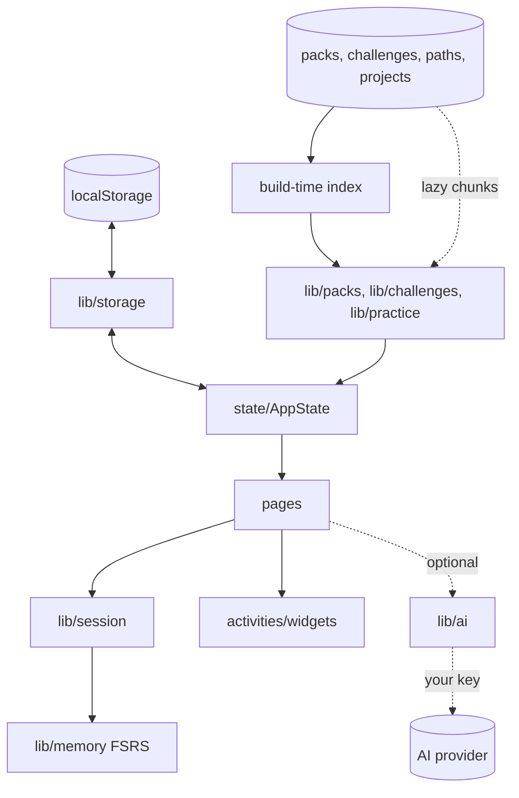

Lists and search use a small index built at compile time. Full lessons, challenge statements and widgets
load when you open them, and the service worker caches them for offline use.

State has one owner: `AppProvider` holds progress, practice, stats, settings and user packs, and every
change goes through an action that also persists it and unlocks achievements. The `lib/` modules do not
import React, so they are tested directly.

## Data and privacy

- All data lives in this browser's `localStorage`. Clearing site data removes it.
- **Settings > Back up** downloads everything as JSON (without your API key). **Restore** accepts backups
  from this version and earlier ones.
- With the app open in two tabs, each tab picks up the other's changes instead of overwriting them.
- No analytics. Fonts are bundled. Two kinds of outbound request exist: the AI requests you trigger
  with your own key, and Pyodide (the Python runtime for challenges and the code runner), which loads
  from the jsDelivr CDN the first time you run Python.

## Deployment

The app is a static site, so it can be hosted for free. The repository includes a `netlify.toml`, which
makes Netlify the quickest option:

1. Sign in at [app.netlify.com](https://app.netlify.com) with your GitHub account (the free plan is enough).
2. **Add new site > Import an existing project**, pick GitHub and choose this repository.
3. Leave the build settings as Netlify fills them in from `netlify.toml` (base `Recurse`, command
   `npm run build`, publish `dist`, Node 22) and choose the `main` branch.
4. Deploy. You get a `*.netlify.app` address within a couple of minutes; rename it under **Site
   configuration > Change site name**, or add your own domain.

Every push to `main` deploys again, and pull requests get their own preview links. Everything (progress,
settings, API keys) stays in each visitor's browser, so there is no server or database to run.

Other free static hosts work too: Cloudflare Pages and Vercel (`Recurse/vercel.json` is included; set the
project root directory to `Recurse`). On any host, build with `npm run build`, serve `Recurse/dist/`, and
make every route fall back to `index.html`. After a deploy, open pages pick up the new version on the next
navigation because the service worker fetches HTML from the network first.

## Troubleshooting

<details>
<summary>The app looks out of date after an update</summary>

Reload once. If it persists, open the browser's developer tools, unregister the service worker for the
site and reload. HTML is always fetched fresh when online, so this should only happen offline.
</details>

<details>
<summary>"Progress could not be saved"</summary>

The browser refused to write to `localStorage`. This happens in some private browsing modes or when site
storage is full or disabled. Download a backup from Settings, then allow storage for the site.
</details>

<details>
<summary>Python challenges say the runtime could not load</summary>

Pyodide loads from cdn.jsdelivr.net the first time. Check that the site is not blocked by an extension or
network filter, then use **Retry**. JavaScript challenges work offline.
</details>

<details>
<summary>AI requests fail</summary>

Use **Settings > Test connection**. A rejected key, a model name the provider does not offer, or an
account without credit are the usual causes. The error message from the provider is shown.
</details>

<details>
<summary><code>npm run screenshots</code> cannot find a browser</summary>

Install Chromium for Playwright once with `npx playwright install chromium`, then build and run it again.
</details>

## Contributing

Issues and pull requests are welcome, especially new topics, labs, challenges and corrections.

1. Fork and create a branch.
2. For content, follow the guides in [`docs/`](Recurse/docs) and check facts carefully.
3. Run `npm run check` in `Recurse/`.
4. Open a pull request describing what changed and why.

See [`ROADMAP.md`](Recurse/ROADMAP.md) for planned work.

## License

[MIT](LICENSE)
